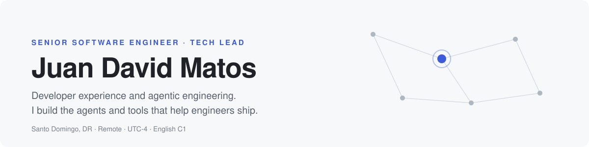

<picture>
  <source media="(prefers-color-scheme: dark)" srcset="./assets/header-dark.svg" />
  <source media="(prefers-color-scheme: light)" srcset="./assets/header-light.svg" />
  
</picture>

  
  
  
  

 

### About

I'm a senior software engineer and tech lead with 6+ years shipping production systems on **TypeScript, Node.js, NestJS, .NET and AWS**. I led a team of up to 12 engineers for about 2.5 years. Today I build for other developers: agent loops that fix failing builds, run tests and open pull requests, shared agent workflows a whole team uses every day, and a path to production with quality gates, observability and DORA metrics.

<table>
  <tr>
    <td align="center" width="25%"><h3>6+</h3>years in production</td>
    <td align="center" width="25%"><h3>12</h3>engineers led</td>
    <td align="center" width="25%"><h3>470+</h3>tests in my current suite</td>
    <td align="center" width="25%"><h3>AWS</h3>Certified Cloud Practitioner</td>
  </tr>
</table>

 

### Agents I've built

Two AI agents I built. Each picture follows one request from start to finish.

<picture>
  <source media="(prefers-color-scheme: dark)" srcset="./assets/agent-support-dark.svg" />
  <source media="(prefers-color-scheme: light)" srcset="./assets/agent-support-light.svg" />
  
</picture>

**Support automation agent.** Built for a client with n8n and LLM tool calling. It understands an incoming request, resolves the support ticket, opens a pull request and updates the project board, so routine engineering tasks need less manual handling.

<picture>
  <source media="(prefers-color-scheme: dark)" srcset="./assets/agent-customer-dark.svg" />
  <source media="(prefers-color-scheme: light)" srcset="./assets/agent-customer-light.svg" />
  
</picture>

**Customer service agent.** An LLM agent that answers from real customer data and context instead of guessing. It connects the model to the right data sources and tools, and handles customer data securely.

 

### What I build

<table>
  <tr>
    <td valign="top" width="28%"><b>Self-healing CI loop</b> GitHub Actions · Claude Agent SDK</td>
    <td valign="top">When a build fails, an agent reproduces the error, proposes a patch, runs the suite and opens a PR. A human always approves the merge. Isolated branches, cost limits and a decision log as guardrails.</td>
  </tr>
  <tr>
    <td valign="top"><b>PR review agent with evals</b> MCP · LangGraph · FastAPI</td>
    <td valign="top">An MCP server exposes pull requests and builds to agents. The review agent is a LangGraph graph served through FastAPI and measured against an eval set for precision and cost.</td>
  </tr>
  <tr>
    <td valign="top"><b>Developer platform starter</b> GitHub Actions · Kubernetes · GCP</td>
    <td valign="top">A reusable template with quality and security gates, OpenTelemetry tracing, Helm and Cloud Run deploys, and a DORA metrics dashboard built from the GitHub API.</td>
  </tr>
</table>

 

### Stack

<table>
  <tr>
    <td width="22%"><b>Agents</b></td>
    <td>Claude Agent SDK · MCP · LangGraph · Google ADK · tool calling · evals · Claude Code · n8n</td>
  </tr>
  <tr>
    <td><b>Developer experience</b></td>
    <td>GitHub Actions · Azure DevOps · CodeQL · SonarQube · gitleaks · OpenTelemetry · SLOs · DORA / SPACE</td>
  </tr>
  <tr>
    <td><b>Backend</b></td>
    <td>TypeScript · Node.js · NestJS · Fastify · Python · FastAPI · .NET / C# · GraphQL · REST</td>
  </tr>
  <tr>
    <td><b>Cloud</b></td>
    <td>AWS (Lambda, API Gateway, SQS, SNS, EventBridge) · GCP (Cloud Run) · Azure · Docker · Kubernetes · Helm · Terraform</td>
  </tr>
  <tr>
    <td><b>Data</b></td>
    <td>PostgreSQL · SQL Server · MongoDB · Redis · Elasticsearch · DynamoDB</td>
  </tr>
  <tr>
    <td><b>Frontend</b></td>
    <td>React · Next.js · Angular · Blazor</td>
  </tr>
</table>

  

 

### Experience

<table>
  <tr>
    <td valign="top" width="28%"><b>Arroyo Consulting</b> Mar 2025 – now</td>
    <td valign="top"><b>Senior Software Engineer · Tech Lead</b> Tech lead of an internal enterprise platform and owner of its path to production on Azure. Designed the AI-assisted workflow the team uses daily: shared Claude Code agents for code review and architecture compliance, backed by a 470+ test suite. AWS microservices with Lambda and API Gateway.</td>
  </tr>
  <tr>
    <td valign="top"><b>Perceny</b> Dec 2024 – Apr 2025</td>
    <td valign="top"><b>Senior Software Engineer</b> REST and GraphQL APIs with NestJS for multi-tenant SaaS products, end to end across Next.js and Node.js.</td>
  </tr>
  <tr>
    <td valign="top"><b>Solvex Dominicana</b> Oct 2021 – Oct 2024</td>
    <td valign="top"><b>Team Lead / Lead Developer</b> Promoted to lead a team of up to 12: technical direction, code reviews and engineering standards. Event-driven microservices in NestJS on AWS (Lambda, EventBridge, SQS, SNS, API Gateway) for high-volume transactional workloads.</td>
  </tr>
  <tr>
    <td valign="top"><b>Independent</b> 2019 – 2021</td>
    <td valign="top"><b>Freelance Software Developer</b> Client projects in Java / Spring Boot, Oracle PL/SQL, React and Node.js, with Jenkins pipelines to OpenShift.</td>
  </tr>
</table>

 

  Let's talk: <a href="mailto:juandmatos0014@gmail.com">juandmatos0014@gmail.com</a> · <a href="https://linkedin.com/in/juan-david-matos-553a73204">LinkedIn</a> · <a href="https://www.hackerrank.com/juand0014">HackerRank</a> · <a href="https://www.leetcode.com/juand0014">LeetCode</a>

