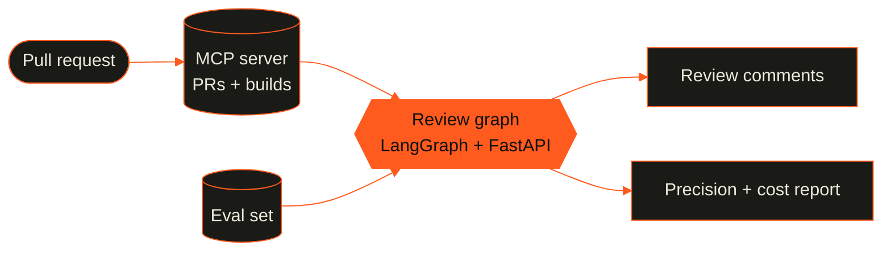

<div align="center">


<br />

<a href="mailto:juandmatos0014@gmail.com"></a>
<a href="https://linkedin.com/in/juan-david-matos-553a73204"></a>
<a href="https://wa.me/18299357237?text=Hi%20Juan%2C%20I%20saw%20your%20GitHub%20profile"></a>


</div>

<br />

## `01` TASK

> [!TIP]
> **Open to remote senior / staff roles in developer experience, platform and agentic engineering.**
> Santo Domingo, Dominican Republic (UTC-4 all year, no daylight saving). English C1, Spanish native.

I'm a senior software engineer and tech lead with 6+ years shipping production systems on **TypeScript, Node.js / NestJS, .NET and AWS**. I led a team of up to 12 engineers for about 2.5 years. Today I build for other developers: **agent loops that fix failing builds, run tests and open pull requests**, shared agent workflows a whole team uses every day, and a path to production with quality gates, observability and DORA metrics.

<div align="center">

<a href="mailto:juandmatos0014@gmail.com"><kbd>&nbsp;⏎&nbsp; run: hire Juan&nbsp;</kbd></a>

</div>

<br />

## `02` PLAN

*What I build.* An agent loop that keeps the main branch green, with a human always approving the merge:

```mermaid
%%{init: {'theme':'base','themeVariables':{'primaryColor':'#1A1B17','primaryTextColor':'#EDE8DA','primaryBorderColor':'#FF5B1F','lineColor':'#FF5B1F','secondaryColor':'#1A1B17','tertiaryColor':'#0E0F0C','fontFamily':'trebuchet ms, verdana, arial, sans-serif'}}}%%
flowchart LR
    F(["CI build fails"]) --> A{{"Fix agent<br/>Agent SDK + MCP"}}
    A --> R["Reproduces the error"]
    R --> P["Proposes a patch"]
    P --> T["Runs the test suite"]
    T --> PR["Opens a PR"]
    PR --> H(["Human approves"])
    classDef hot fill:#FF5B1F,stroke:#FF5B1F,color:#0E0F0C;
    class A hot;
```



A review agent measured against an eval set, not vibes:



Also shipped: an n8n agent that resolves support tickets, opens pull requests and updates the project board, and a customer-service agent grounded in real customer data.

<details>
<summary><b>Ask me about…</b></summary>
<br />

- **Leading 12 engineers.** Technical direction, code reviews, engineering standards, mentoring, and working closely with Product (about 2.5 years at Solvex Dominicana).
- **Event-driven microservices on AWS.** Node.js (Nest) on Lambda, EventBridge, SQS, SNS and API Gateway for high-volume transactional workloads.
- **Agents that touch real systems.** Agent loops in CI with guardrails (isolated branches, cost limits, human approval), MCP servers, and how to measure whether an agent improves quality instead of just producing more code.
- **Developer experience.** Rolling out a shared AI-assisted workflow (Claude Code agents for code review and architecture compliance, skills, rules) to a product team, plus quality and security gates and DORA / SPACE metrics.

</details>

<br />

## `03` TOOLS

```yaml
agents:   [Claude Agent SDK, MCP, LangGraph, Google ADK, tool calling, evals]
devex:    [GitHub Actions, Azure DevOps, quality gates, OpenTelemetry, DORA / SPACE]
backend:  [TypeScript, Node.js, NestJS, Python, FastAPI, .NET / C#]
cloud:    [AWS, GCP (Cloud Run), Azure, Docker, Kubernetes, Helm, Terraform]
data:     [PostgreSQL, SQL Server, MongoDB, Redis, Elasticsearch]
frontend: [React, Next.js, Angular, Blazor]
```

<div align="center">


</div>

<details>
<summary><b>tools --all</b></summary>
<br />

**Languages:** TypeScript, JavaScript, C#, Java, Python
**Frameworks:** NestJS, Express, Fastify, FastAPI, React, Next.js, Angular, Blazor, ASP.NET Core, Spring Boot
**Cloud and DevOps:** AWS (Certified Cloud Practitioner), GCP, Azure, Docker, Kubernetes, Helm, OpenShift, Terraform, Kafka, GitHub Actions, Azure DevOps, Jenkins
**Data:** PostgreSQL, MongoDB, SQL Server, Oracle, Redis, Elasticsearch
**Agents and AI:** Claude Agent SDK, MCP, LangGraph, Google ADK, LLM evals, tool calling, RAG, n8n, Claude Code, Cursor, GitHub Copilot
**Developer experience:** CI/CD, CodeQL, SonarQube, gitleaks, Dependabot, OpenTelemetry, SLOs, DORA and SPACE metrics
**Testing:** Jest, Vitest, pytest, xUnit, Playwright
**Practice:** event-driven architecture, microservices, DDD, Clean Architecture, Scrum, Kanban

</details>

<br />

## `04` MEMORY

<details open>
<summary><b>Senior Software Engineer · Tech Lead</b> · Arroyo Consulting · <code>Mar 2025 → now</code></summary>
<br />

Technical lead of an internal enterprise platform, owning its path to production on Azure. Designed the AI-assisted workflow the team uses every day: shared **Claude Code agents for code review and architecture compliance**, skills and rules, backed by a 470+ test suite and an agent-driven QA loop. LLM features in the product with model routing, versioned prompts and PII redaction. **.NET, Node.js / TypeScript, AWS (Lambda, API Gateway) and Azure.**

</details>

<details open>
<summary><b>Team Lead / Lead Developer</b> · Solvex Dominicana · <code>Oct 2021 → Oct 2024</code></summary>
<br />

Joined as a full-stack engineer and was promoted to lead a team of **up to 12**: set technical direction, ran code reviews and defined engineering standards. Architected **event-driven microservices** in Node.js (Nest) on AWS (Lambda, EventBridge, SQS, SNS, API Gateway) for high-volume transactional workloads, and built marketplace and SaaS features with Next, Nest and .NET Core.

</details>

<details>
<summary><b>Senior Software Engineer</b> · Perceny · <code>Dec 2024 → Apr 2025</code></summary>
<br />

REST and GraphQL APIs with NestJS powering multi-tenant SaaS products, built end to end across a Next / Nest / React Native stack.

</details>

<details>
<summary><b>Freelance Software Developer</b> · Independent · <code>2019 → 2021</code></summary>
<br />

Short-term client projects across Java / Spring Boot, .NET / C#, JavaScript, React and Oracle PL/SQL backends.

</details>

<br />

## `05` OUTPUT

<div align="center">

<a href="mailto:juandmatos0014@gmail.com"></a>
<a href="https://linkedin.com/in/juan-david-matos-553a73204"></a>
<a href="https://wa.me/18299357237?text=Hi%20Juan%2C%20I%20saw%20your%20GitHub%20profile"></a>

<sub><a href="https://wa.me/18299357237">WhatsApp +1 829 935 7237</a> · <a href="https://www.hackerrank.com/juand0014">HackerRank</a> · <a href="https://www.leetcode.com/juand0014">LeetCode</a> · juandmatos0014@gmail.com</sub>


</div>
